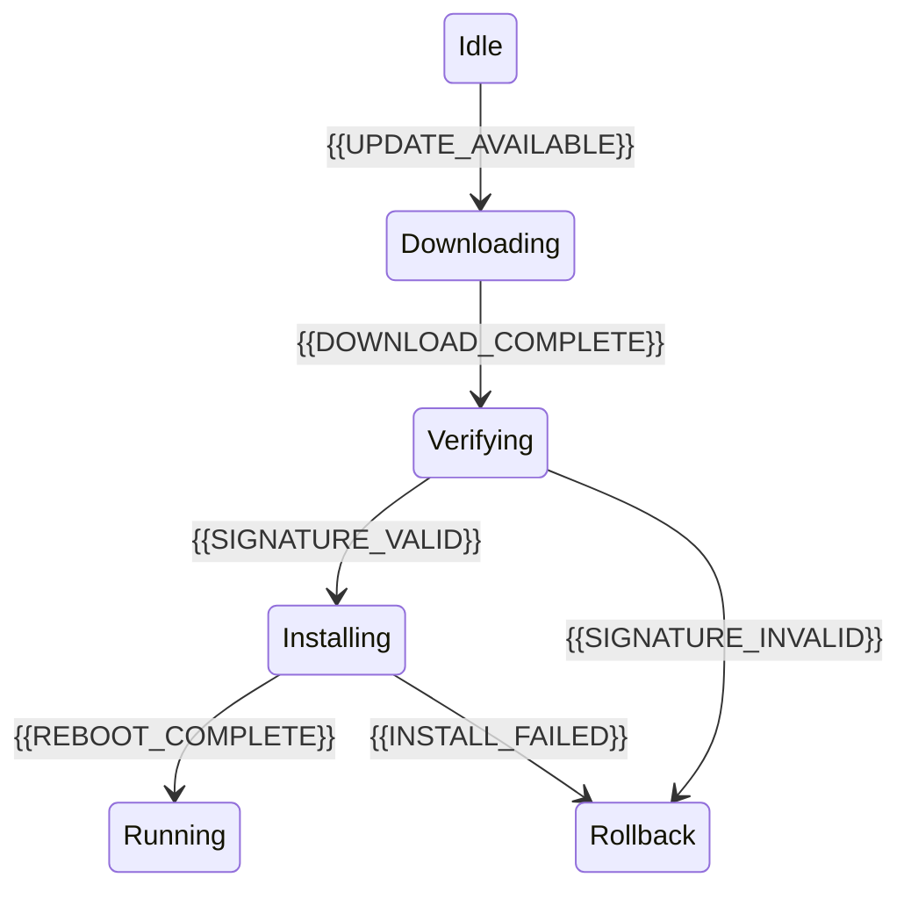

# Firmware Update Flow

[← Table of Contents]({{INDEX_PATH}}) · *IoT Edge Module*

## Table of Contents

{{TOC_LINKS}}

{{FIRMWARE_UPDATE_SUMMARY}}

## Update Lifecycle

## Update Policy

| Stage | Requirement | Failure Handling | Security Control | Telemetry |
|---|---|---|---|---|
{{FIRMWARE_UPDATE_ROWS}}
## Assumptions and Open Questions

{{ASSUMPTIONS}}

## Self-Check

{{SELF_CHECK_NOTE}}

## Related Docs

{{RELATED_DOC_LINKS}}
