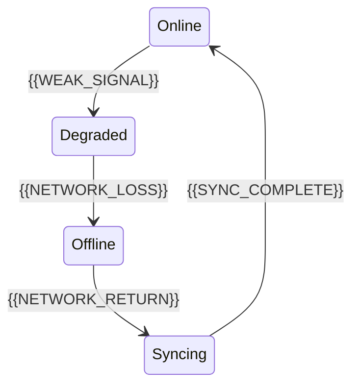

# Offline And Degraded Behavior

[← Table of Contents]({{INDEX_PATH}}) · *IoT Edge Module*

## Table of Contents

{{TOC_LINKS}}

{{OFFLINE_DEGRADED_SUMMARY}}

## Connectivity States

## Degraded Mode Matrix

| Condition | Allowed Behavior | Blocked Behavior | Local Storage | Recovery |
|---|---|---|---|---|
{{OFFLINE_DEGRADED_ROWS}}
## Assumptions and Open Questions

{{ASSUMPTIONS}}

## Self-Check

{{SELF_CHECK_NOTE}}

## Related Docs

{{RELATED_DOC_LINKS}}
