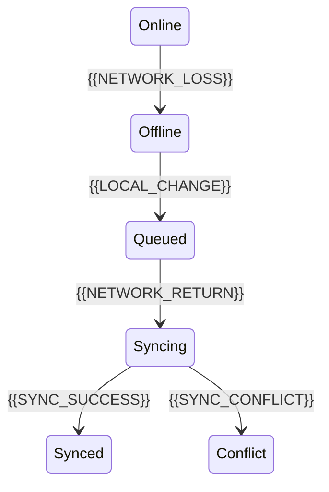

# Offline Sync Strategy

[← Table of Contents]({{INDEX_PATH}}) · *Mobile Module*

## Table of Contents

{{TOC_LINKS}}

{{OFFLINE_SYNC_SUMMARY}}

## Sync Lifecycle

## Sync Rules

| Data | Offline Behavior | Conflict Rule | Retry | User Feedback |
|---|---|---|---|---|
{{OFFLINE_SYNC_ROWS}}
## Assumptions and Open Questions

{{ASSUMPTIONS}}

## Self-Check

{{SELF_CHECK_NOTE}}

## Related Docs

{{RELATED_DOC_LINKS}}
