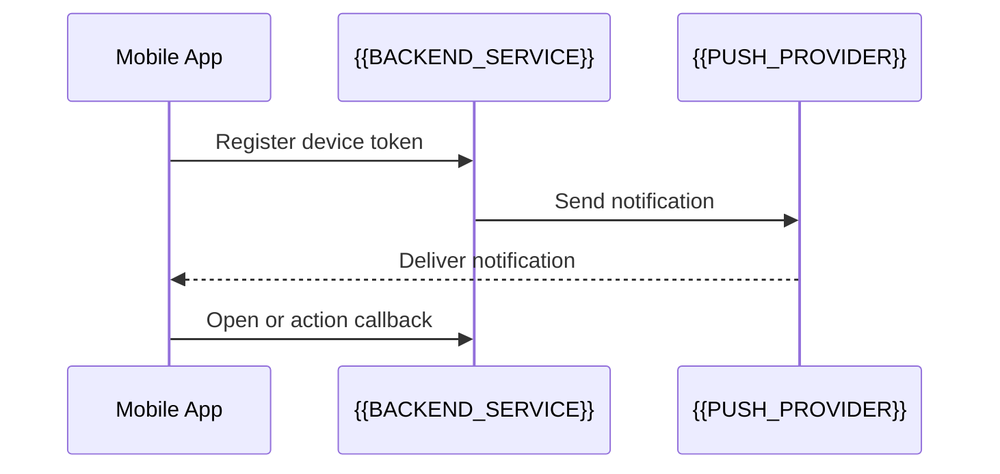

# Push Notification Flow

[← Table of Contents]({{INDEX_PATH}}) · *Mobile Module*

## Table of Contents

{{TOC_LINKS}}

{{PUSH_NOTIFICATION_SUMMARY}}

## Push Sequence

## Notification Catalog

| Notification | Trigger | Payload | Permission | Fallback |
|---|---|---|---|---|
{{PUSH_NOTIFICATION_ROWS}}
## Assumptions and Open Questions

{{ASSUMPTIONS}}

## Self-Check

{{SELF_CHECK_NOTE}}

## Related Docs

{{RELATED_DOC_LINKS}}
