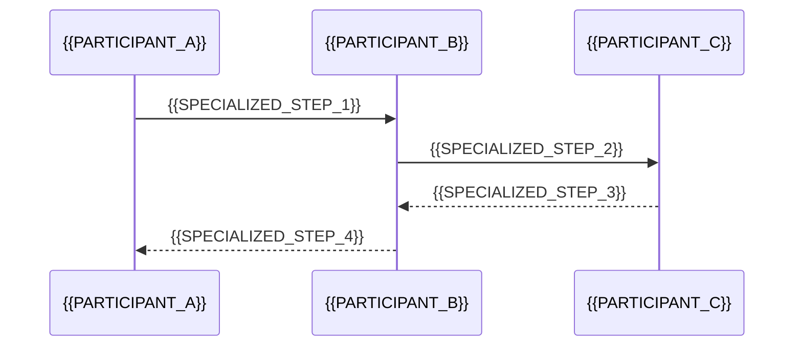

# {{EXTENSION_TITLE}}

[← Table of Contents]({{INDEX_PATH}}) · *Project Type Extension*

## Table of Contents

{{TOC_LINKS}}

{{EXTENSION_SUMMARY}}

## Why This Module Is Active

{{ACTIVATION_REASON}}

## Specialized Design Detail

| Concern | Decision | Detail | Risk |
|---|---|---|---|
{{SPECIALIZED_DESIGN_ROWS}}

## Specialized Flow

## Assumptions and Open Questions

{{ASSUMPTIONS}}

## Self-Check

{{SELF_CHECK_NOTE}}

## Related Docs

{{RELATED_DOC_LINKS}}
