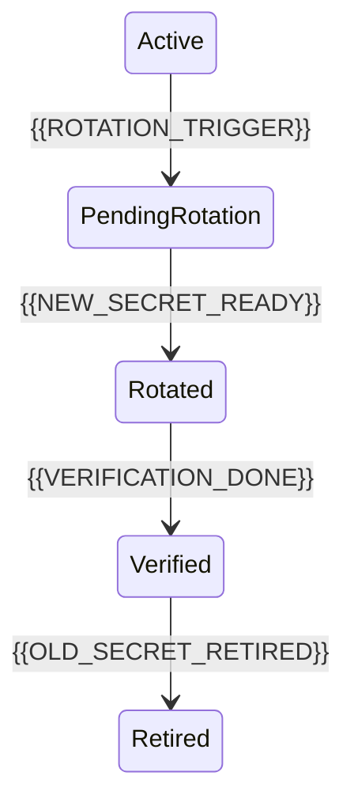

# Key And Secret Rotation

[← Table of Contents]({{INDEX_PATH}}) · *Security Critical Module*

## Table of Contents

{{TOC_LINKS}}

{{KEY_SECRET_ROTATION_SUMMARY}}

## Rotation Lifecycle

## Rotation Matrix

| Secret/Key Name | Storage | Rotation Frequency | Owner | Rollback |
|---|---|---|---|---|
{{KEY_SECRET_ROTATION_ROWS}}
## Assumptions and Open Questions

{{ASSUMPTIONS}}

## Self-Check

{{SELF_CHECK_NOTE}}

## Related Docs

{{RELATED_DOC_LINKS}}
