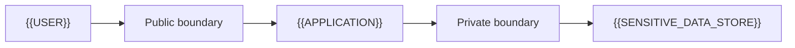

# Threat Model

[← Table of Contents]({{INDEX_PATH}}) · *Security Critical Module*

## Table of Contents

{{TOC_LINKS}}

{{THREAT_MODEL_SUMMARY}}

## Trust Boundary Diagram

## Threat Catalog

| Threat | Asset | Attack Path | Impact | Control |
|---|---|---|---|---|
{{THREAT_MODEL_ROWS}}
## Assumptions and Open Questions

{{ASSUMPTIONS}}

## Self-Check

{{SELF_CHECK_NOTE}}

## Related Docs

{{RELATED_DOC_LINKS}}
