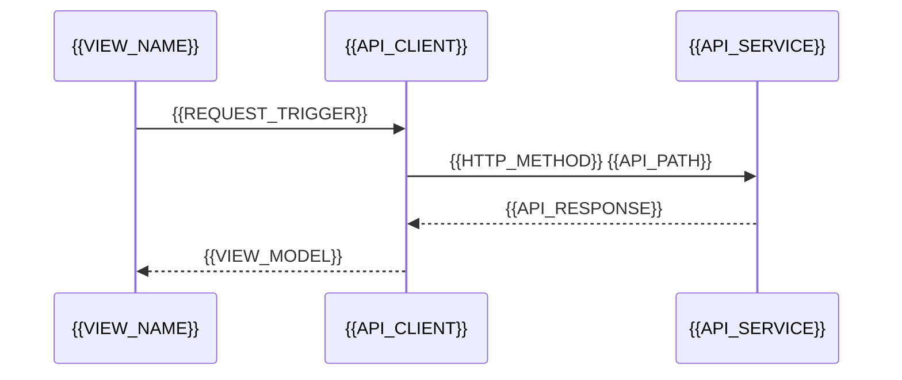

# Frontend API Binding

[← Table of Contents]({{INDEX_PATH}}) · *Web App Module*

## Table of Contents

{{TOC_LINKS}}

{{FRONTEND_API_BINDING_SUMMARY}}

## API Binding Sequence

## Binding Matrix

| Screen | Trigger | API/Message | Params | Response Mapping | Cache Rule |
|---|---|---|---|---|---|
{{FRONTEND_API_BINDING_ROWS}}

## Error Mapping

| API Error | UI State | User Message | Retry Rule |
|---|---|---|---|
{{FRONTEND_API_ERROR_ROWS}}
## Assumptions and Open Questions

{{ASSUMPTIONS}}

## Self-Check

{{SELF_CHECK_NOTE}}

## Related Docs

{{RELATED_DOC_LINKS}}
