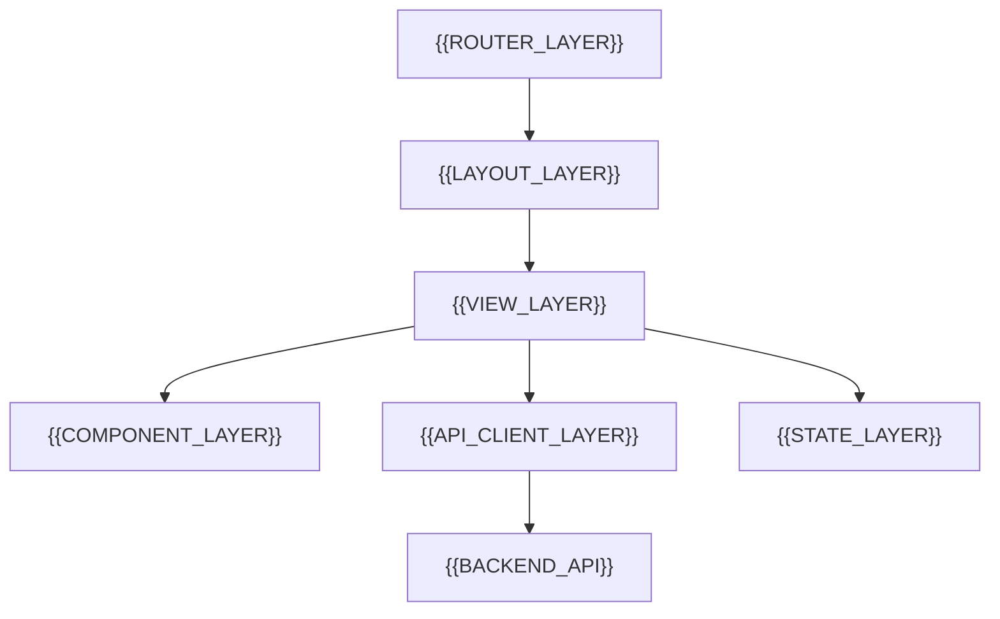

# Frontend Architecture

[← Table of Contents]({{INDEX_PATH}}) · *Web App Module*

## Table of Contents

{{TOC_LINKS}}

{{FRONTEND_ARCHITECTURE_SUMMARY}}

## Frontend Structure

## Frontend Layers

| Layer | Responsibility | Technology | Change Risk |
|---|---|---|---|
{{FRONTEND_LAYER_ROWS}}

## Boundary Rules

| Boundary | Allowed Dependency | Forbidden Dependency | Reason |
|---|---|---|---|
{{FRONTEND_BOUNDARY_ROWS}}
## Assumptions and Open Questions

{{ASSUMPTIONS}}

## Self-Check

{{SELF_CHECK_NOTE}}

## Related Docs

{{RELATED_DOC_LINKS}}
