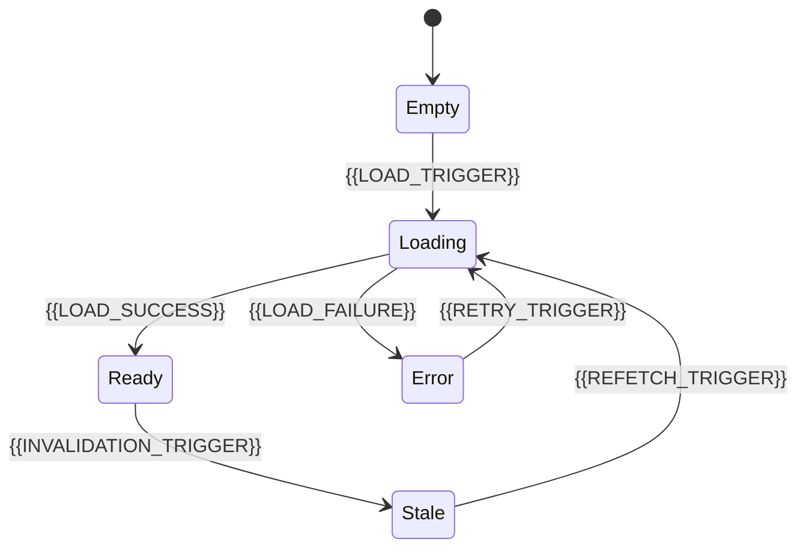

# State Management

[← Table of Contents]({{INDEX_PATH}}) · *Web App Module*

## Table of Contents

{{TOC_LINKS}}

{{STATE_MANAGEMENT_SUMMARY}}

## State Lifecycle

## State Catalog

| ID | State Type | Owner | Source | Cache/Invalidation | Failure State |
|---|---|---|---|---|---|
{{STATE_ROWS}}

## Realtime Or Sync Behavior

| Signal | Trigger | UI Update | Conflict Rule |
|---|---|---|---|
{{STATE_SYNC_ROWS}}
## Assumptions and Open Questions

{{ASSUMPTIONS}}

## Self-Check

{{SELF_CHECK_NOTE}}

## Related Docs

{{RELATED_DOC_LINKS}}
