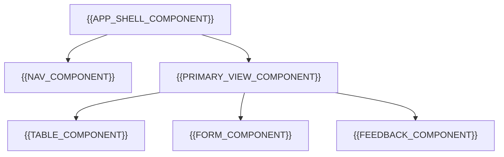

# UI Component Catalog

[← Table of Contents]({{INDEX_PATH}}) · *Web App Module*

## Table of Contents

{{TOC_LINKS}}

{{COMPONENT_CATALOG_SUMMARY}}

## Component Map

## Component Contracts

| Component | Purpose | Props/Data | Events | States |
|---|---|---|---|---|
{{UI_COMPONENT_ROWS}}

## Reuse Rules

| Rule | Applies To | Reason | Exception |
|---|---|---|---|
{{COMPONENT_REUSE_RULE_ROWS}}
## Assumptions and Open Questions

{{ASSUMPTIONS}}

## Self-Check

{{SELF_CHECK_NOTE}}

## Related Docs

{{RELATED_DOC_LINKS}}
