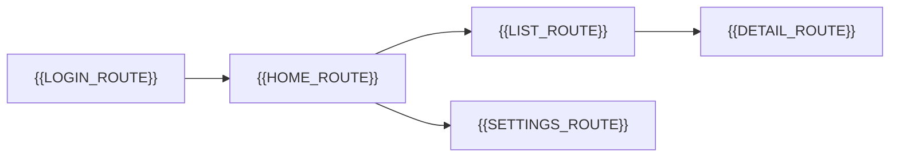

# UI Route Map

[← Table of Contents]({{INDEX_PATH}}) · *Web App Module*

## Table of Contents

{{TOC_LINKS}}

{{ROUTE_MAP_SUMMARY}}

## Route Diagram

## Route Catalog

| ID | Route | Purpose | Access | Data/API | State |
|---|---|---|---|---|---|
{{ROUTE_ROWS}}

## Route Guard Rules

| Route | Guard | Redirect | Failure State |
|---|---|---|---|
{{ROUTE_GUARD_ROWS}}
## Assumptions and Open Questions

{{ASSUMPTIONS}}

## Self-Check

{{SELF_CHECK_NOTE}}

## Related Docs

{{RELATED_DOC_LINKS}}
