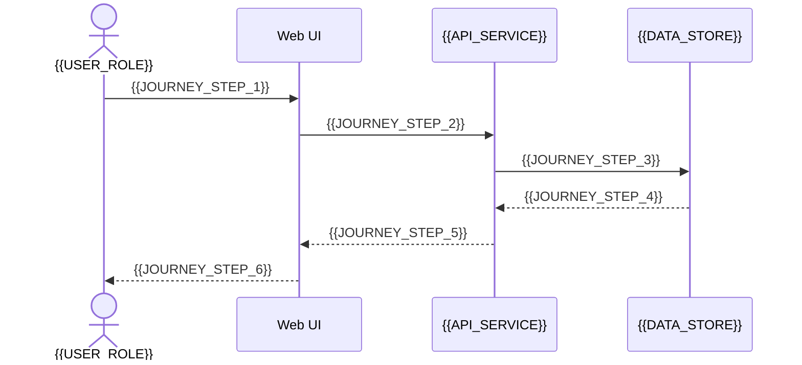

# {{JOURNEY_NAME}}

[← Table of Contents]({{INDEX_PATH}}) · *Web App Module*

## Table of Contents

{{TOC_LINKS}}

{{JOURNEY_SUMMARY}}

## Journey Sequence

## Screen Steps

| Step | Screen | User Action | System Response | Error/Fallback |
|---|---|---|---|---|
{{JOURNEY_STEP_ROWS}}

## Linked Contracts

| Requirement | Flow | API/Message | Entity | Test |
|---|---|---|---|---|
{{JOURNEY_TRACE_ROWS}}
## Assumptions and Open Questions

{{ASSUMPTIONS}}

## Self-Check

{{SELF_CHECK_NOTE}}

## Related Docs

{{RELATED_DOC_LINKS}}
