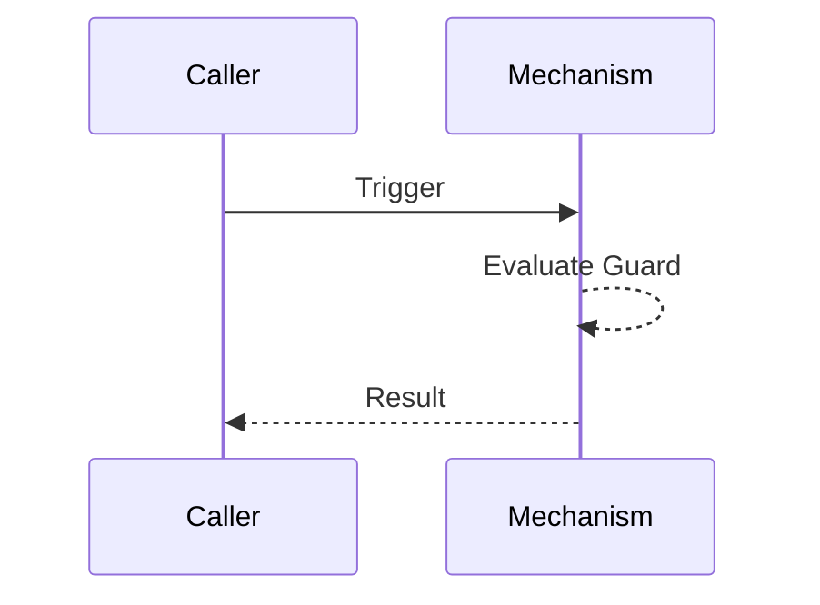

# {{PLACEHOLDER: Mechanism Name}} [MECH-001]

[← Mechanism Catalog](mechanism-design.md) | [← Table of Contents](../index.md)

## Summary

{{PLACEHOLDER: A concise statement of what this mechanism does and why it exists.}}

## Core Description & Mechanisms

{{PLACEHOLDER: Explain the exact "how" and "why" in deep technical prose. Do NOT use bullet lists. Describe the algorithm, exact technical guardrails, state transitions, and how it behaves under concurrency or failure. Ensure all normative defaults (e.g., timeout=30s, initial_delay=500ms) are explicitly justified in the text.}}

## Lifecycle Diagram

## Detailed Tables & Data Contracts (If Applicable)

{{PLACEHOLDER: Only use this section if there is a strict structured schema or matrix required to complement the core description. Otherwise, leave empty or remove.}}

## Self-Check
- [ ] Diagram accurately reflects the runtime lifecycle.
- [ ] Guard conditions explicitly name the failure mode they prevent.
- [ ] Concurrency implications are defined.
