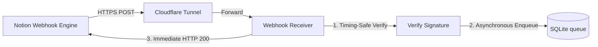

# Real-time Webhook Receiver & Server-Sent Events Pipeline

[← Table of Contents](../index.md) · [Runtime Mechanisms](mechanism-design.md)

## 1. Summary
Architecture specification for ingest-and-queue webhook receiver pipelines, secure cryptographic verification, and push-based Server-Sent Events (SSE) synchronization. Guarantees timing-safe message integrity, sub-second client updates, and prevents webhook event processing from blocking HTTP request handlers.

## 2. Ingestion & Tunneling Architecture
- **Tunneling:** Cloudflare named tunnel (`cloudflared`) exposing local port (e.g. `8788` for webhook, `8787` for UI) to Notion's subscription callback.
- **Worker Queuing SLA:** Webhook receiver dispatches events to a single-threaded database-backed queue (SQLite `events` table) within 3 seconds, responding `200 OK` to Notion before executing any Notion API operations.

## 3. Cryptographic Signature Verification
- **HMAC Verification:** Computes `HMAC-SHA256(request_body, verification_token)`.
- **Timing-Safe Equality:** Must utilize a timing-safe equals function (e.g., `crypto.timingSafeEqual` in Node.js) to prevent timing side-channel attacks when comparing the calculated hash against `X-Notion-Signature`.
- **Duplication Prevention:** Deduplicates events based on `event_id` in database table before starting ingestion.

## 4. Server-Sent Events (SSE) Pipeline
- **Channel:** `/api/events` connection from Browser client.
- **Propagation SLA:** Real-time push updates dispatched to frontend client within 2 seconds after the worker completes event execution (SSE).
- **Notifications:** Prompts OS/browser notifications on the UI when new comments or tasks are received.

## 5. Failure Recovery
- **Process Crash:** Events in SQLite database `events` marked as `pending` are resumed chronologically upon restart.
- **Tunnel Death:** Health check pings `cloudflared` process every 30s; auto-restarts up to 3 times before raising a visual alert.
