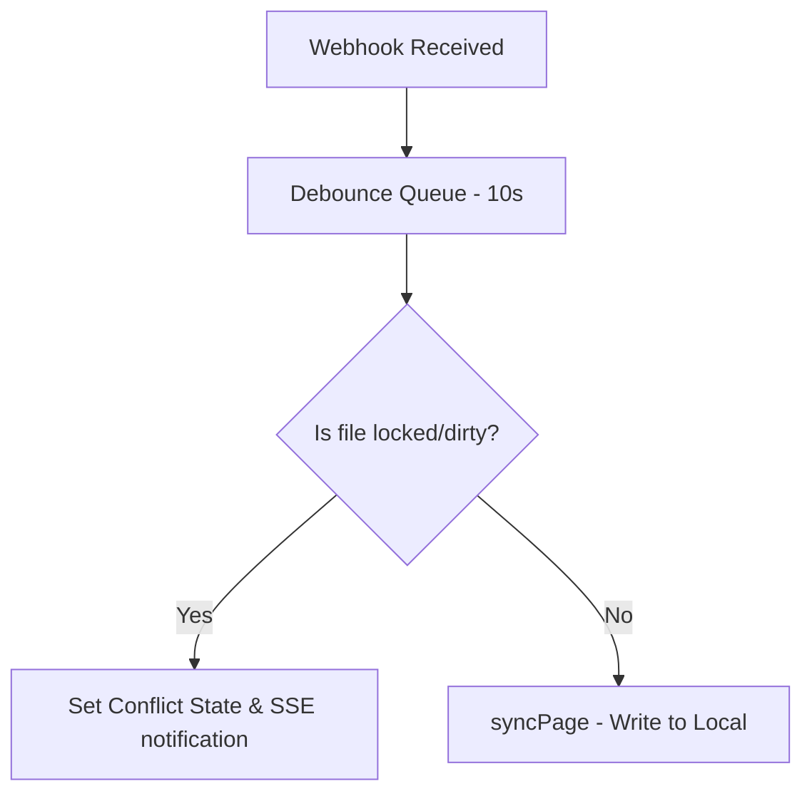

# State Synchronization and Conflict Resolution Mechanism

[← Table of Contents](../index.md) · [Runtime Mechanisms](mechanism-design.md)

## 1. Summary
Architecture specification for bi-directional state synchronization, change diffing, conflict detection, and remote annotation preservation. Prevents silent data overwrites, data loss on inline comments, and infinite sync loops.

## 2. Runtime Principle
### Reconciliation Loop & Debouncing
- **Triggering events:** Periodic intervals (e.g. 6 hours) or immediate webhook triggers.
- **Debounce Window:** 10s debounce on identical entity IDs to prevent high-frequency write storms.
- **Reconciliation Engine:**
  - Remote check: Poll `last_edited_time` for all remote documents.
  - Lateness threshold: If remote is newer than local DB state, pull remote blocks down.

## 3. Diff Engine & LCS Algorithm
- **Block-level Hashing:** Each block (paragraph, list, code block) is hashed.
- **LCS (Longest Common Subsequence) mapping:** Computes minimal diff commands:
  - `PATCH`: Modifies existing block content
  - `APPEND`: Inserts block below `after` pointer
  - `DELETE`: Dispatches deletion request
- **Idempotency:** A dry-run comparing local hashes vs remote hashes must yield exactly 0 write requests.

## 4. Conflict Detection & Recovery
- **Diverged Heuristics:**
  - File is locally `dirty=1` (edited) AND remote `last_edited_time` > database cache state.
- **Resolution Modes:**
  - **Take Remote:** Override local file with remote block parse. Clear local `dirty=0`, `conflict=0`.
  - **Keep Local:** Keep local file, force push local state to remote.
  - *No auto-merge is allowed to prevent logical corruption.*

## 5. Comment Preservation Heuristics
- **Comment Association:** Remote inline comments are attached to specific block IDs.
- **Safety Gate:** Any LCS output indicating a `DELETE` command on a block containing active comments MUST raise a blocking warning on UI:
  - UI checkbox verification is required before allowing push.
  - Silent deletion of comment-bearing blocks is forbidden.

## 6. Defaults & Guardrails
- **Backups Keep:** Keep 20 most recent remote JSON snapshot blocks under `.backup/<shortId>/<ISO-timestamp>.json` prior to execution.
- **Retry Backoff:** Exponential backoff `1s -> 2s -> 4s -> 8s -> 16s` (max 5 retries) for rate limits (429) or transient 5xx issues.
