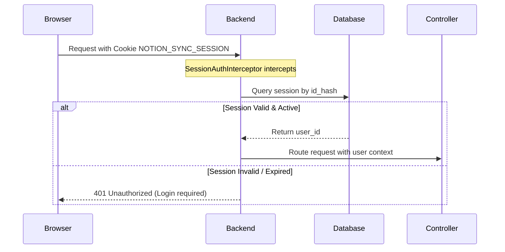

# Cookie-Based User Session Authentication Design

[← Table of Contents](../index.md) · [Security Design](security.md)

## 1. Summary
Architecture specification for separating system-level backend integration tokens (Notion API Token) from end-user app authentication (Cookie sessions). Prevents unauthorized access, identity spoofing, and API token leakage.

## 2. Authentication Separation Model
- **Integration/Service Token:** Shared backend config, read from environment (`NOTION_TOKEN`), utilized by the backend server for writing/reading Notion blocks.
- **User Authentication:** Individual cookie-based session established per local app user. Prevents users from manually crafting headers (e.g. `X-User-Id: user2`) to impersonate others.

| Auth Layer | Credential | Owner | Storage |
|---|---|---|---|
| Service Sync | Service Bearer Token | Backend Server | Environment variable |
| App Interface | HTTP Cookie Session | Browser / Client | DB Hashed Sessions |

## 3. Session Cookie Security Attributes
- **Cookie Name:** `NOTION_SYNC_SESSION`
- **Security Flags:**
  - `HttpOnly=true`: Prevent XSS scripts from reading the session token.
  - `SameSite=Lax`: Reduce CSRF risks on browser actions.
  - `Secure=true`: Mandatory for HTTPS environments (may fall back to HTTP for local dev).
- **Session Lifetime:** 7 days rolling expiration.

## 4. Database Schema Requirements
```sql
CREATE TABLE users (
  id TEXT PRIMARY KEY,
  email TEXT UNIQUE NOT NULL,
  display_name TEXT NOT NULL,
  password_hash TEXT NOT NULL,
  created_at TIMESTAMP DEFAULT CURRENT_TIMESTAMP
);

CREATE TABLE sessions (
  id_hash TEXT PRIMARY KEY, -- PBKDF2/bcrypt hash of session token
  user_id TEXT NOT NULL REFERENCES users(id),
  created_at TIMESTAMP DEFAULT CURRENT_TIMESTAMP,
  expires_at TIMESTAMP NOT NULL
);
```

## 5. Execution Flow & Interceptors


## 6. Local Test Credentials
- Pre-seeded local credentials for development environment testing:
  - Owner: `owner@local.test` / `owner`
  - Guest: `guest@local.test` / `guest`
- Production constraint: Default seeds MUST be disabled.
