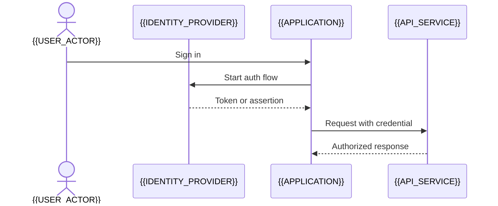

# Security Design

[← Table of Contents]({{INDEX_PATH}}) · *Security*

## Table of Contents

{{TOC_LINKS}}

{{SECURITY_SUMMARY}}

## Identity And Access Flow

## Controls

| Area | Control | Risk Reduced | Verification |
|---|---|---|---|
{{SECURITY_CONTROL_ROWS}}

## Threats And Mitigations

| Threat | Attack Path | Impact | Mitigation | Signal |
|---|---|---|---|---|
{{THREAT_ROWS}}
## Assumptions and Open Questions

{{ASSUMPTIONS}}

## Self-Check

{{SELF_CHECK_NOTE}}

## Related Docs

{{RELATED_DOC_LINKS}}
