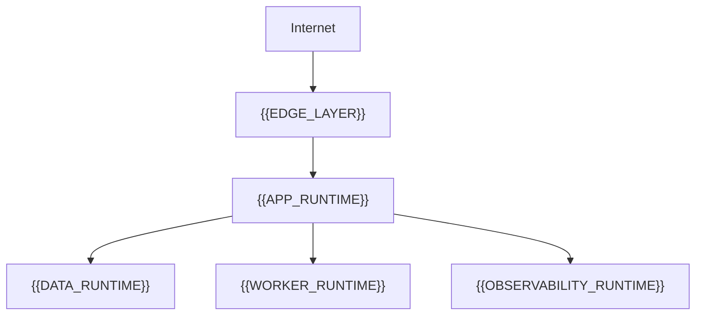
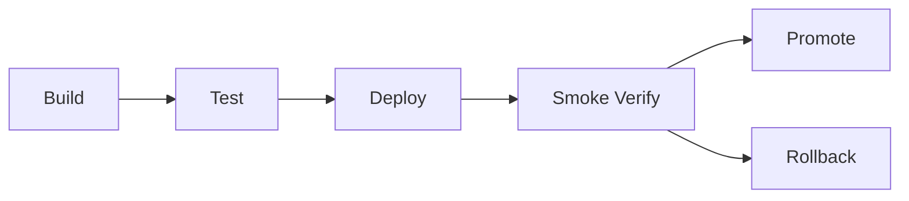

# Infrastructure And Deployment

[← Table of Contents]({{INDEX_PATH}})

## Table of Contents

{{TOC_LINKS}}

{{DEPLOYMENT_SUMMARY}}

## Runtime Topology

| Runtime Unit | Environment | Scaling | Network Boundary | Failure Behavior |
|---|---|---|---|---|
{{RUNTIME_TOPOLOGY_ROWS}}

## Environment Config

Only config key names are documented. Secret values and environment values are intentionally excluded.

| Config Key | Purpose | Required | Stored In | Rotation/Change Rule |
|---|---|---|---|---|
{{CONFIG_KEY_ROWS}}

## Release And Rollback

| Stage | Gate | Owner | Rollback Action |
|---|---|---|---|
{{RELEASE_STAGE_ROWS}}
## Assumptions and Open Questions

{{ASSUMPTIONS}}

## Self-Check

{{SELF_CHECK_NOTE}}

## Related Docs

{{RELATED_DOC_LINKS}}
