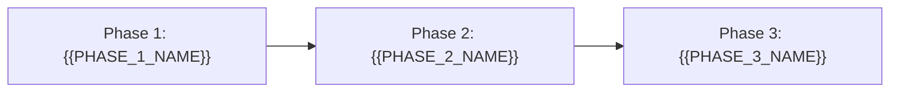

# Roadmap

[← Table of Contents]({{INDEX_PATH}})

## Table of Contents

{{TOC_LINKS}}

{{ROADMAP_SUMMARY}}

## Implementation Phases

| Phase | Scope | Deliverables | Dependency | Exit Criteria |
|---|---|---|---|---|
{{ROADMAP_PHASE_ROWS}}

## MVP Boundary

| Capability | MVP | Later | Reason |
|---|---|---|---|
{{MVP_BOUNDARY_ROWS}}
## Assumptions and Open Questions

{{ASSUMPTIONS}}

## Self-Check

{{SELF_CHECK_NOTE}}

## Related Docs

{{RELATED_DOC_LINKS}}
