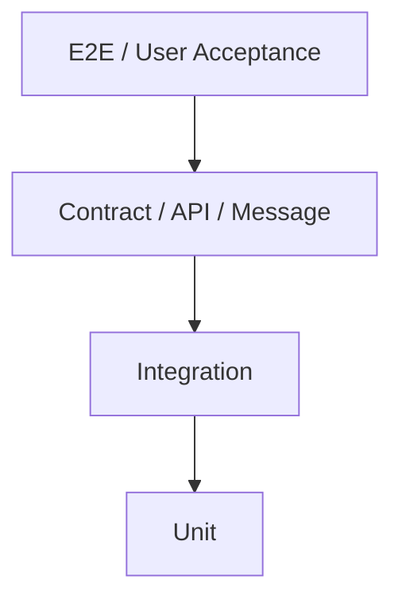

# Testing Strategy

[← Table of Contents]({{INDEX_PATH}})

## Table of Contents

{{TOC_LINKS}}

{{TESTING_SUMMARY}}

## Test Pyramid

| Layer | Scope | Tooling | Entry Criteria | Exit Criteria |
|---|---|---|---|---|
{{TEST_LAYER_ROWS}}

## Acceptance Checks

| Requirement | Scenario | Expected Result | Test Type |
|---|---|---|---|
{{ACCEPTANCE_CHECK_ROWS}}
## Assumptions and Open Questions

{{ASSUMPTIONS}}

## Self-Check

{{SELF_CHECK_NOTE}}

## Related Docs

{{RELATED_DOC_LINKS}}
